<picture>
  <source media="(max-width: 600px) and (prefers-color-scheme: dark)" srcset="assets/header-mobile-dark.svg">
  <source media="(max-width: 600px)" srcset="assets/header-mobile-light.svg">
  <source media="(prefers-color-scheme: dark)" srcset="assets/header-dark.svg">
  
</picture>

<samp><a href="https://chrislrt.com">site</a> · <a href="https://lattices.xyz">arts</a> · <a href="mailto:chris.lrts@gmail.com">email</a></samp>

<!-- DRAFT: intro -->
I'm Chris, co-founder and CTO of [Reshelf](https://reshelf.xyz), a marketplace for second-hand books in Thailand. My co-founder runs everything the world sees; I build everything underneath it.

### Selected work

<!-- Receipt floats beside the list on wide screens; on phones it renders after the list instead. -->
<picture>
  <source media="(max-width: 600px)" srcset="assets/blank.svg">
  <source media="(prefers-color-scheme: dark)" srcset="assets/receipt-dark.svg">
  
</picture>

<!-- DRAFT: the three works -->
- **Listing review with AI** · <samp>2026</samp> Each new listing checked before review
- **Recommendation engine** · <samp>2026</samp> Computed nightly, served in one query
- **Payments & tax receipts** · <samp>2026</samp> Slips verified, documents issued, hands-off

 

<picture>
  <source media="(min-width: 601px)" srcset="assets/blank.svg">
  <source media="(prefers-color-scheme: dark)" srcset="assets/receipt-dark.svg">
  
</picture>

